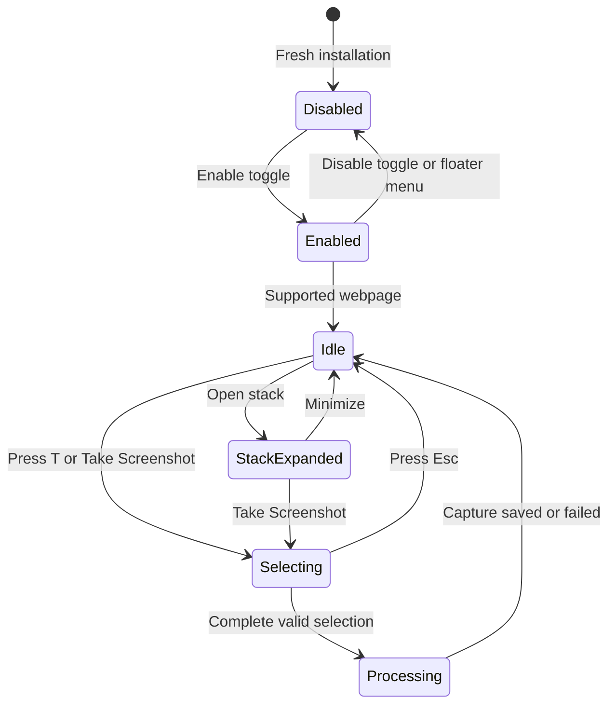
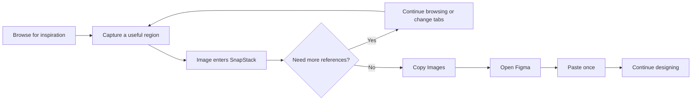
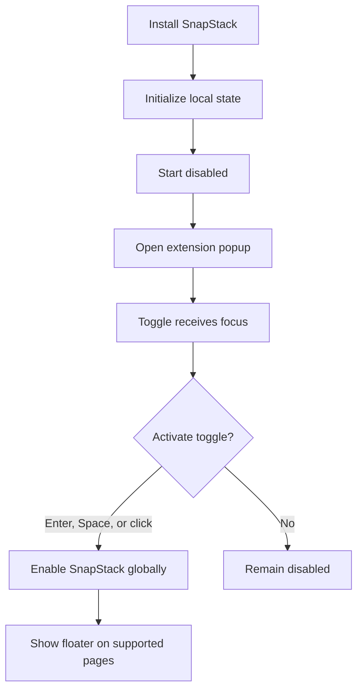
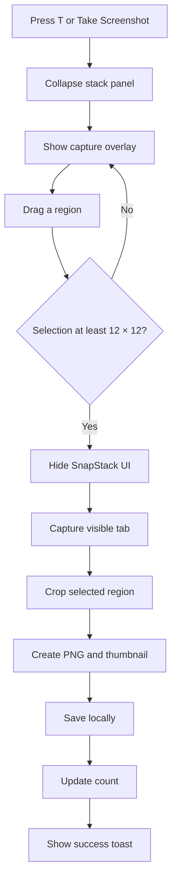
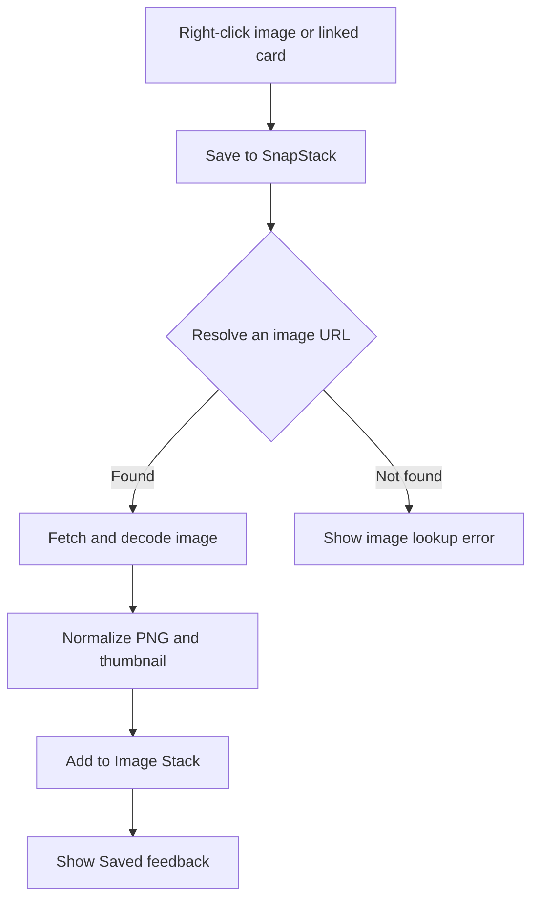
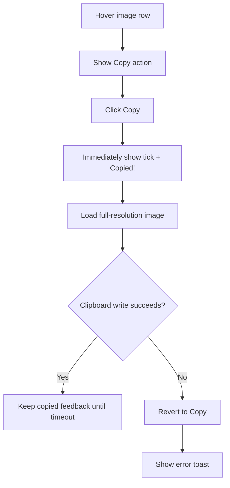

# SnapStack User Flows and Edge-Case Specification

**Product:** SnapStack Chrome Extension  
**Tagline:** Snap. Stack. Stay in flow.  
**Document type:** UX flow and behavior specification  
**Last updated:** 3 August 2026  
**Status:** Current implementation

## 1. Product summary

SnapStack helps designers collect visual references from the web without repeatedly switching between Chrome and Figma.

The traditional workflow is:

> Browse → capture → switch to Figma → paste → return to Chrome → repeat

SnapStack changes it to:

> Browse → capture → stack → continue browsing → copy once → paste in Figma

The extension is not intended to replace a permanent asset library. It is a lightweight, temporary visual buffer between browsing and designing.

## 2. Primary user and job to be done

### Primary user

- Product designers
- UI and visual designers
- Brand designers
- Design researchers
- Anyone collecting multiple visual references before using them in a design tool

### Job to be done

> When I am studying products or collecting inspiration from the web, I want to capture and temporarily stack multiple visual references without leaving Chrome, so I can move them to Figma together and remain focused on exploration.

### Desired experience

- Fast
- Minimal
- Predictable
- Non-disruptive
- Available across tabs
- Immediately responsive

## 3. Product principles

1. **Protect the browsing flow.** Capturing a reference should not force the user to leave Chrome.
2. **Collect first, organize later.** The extension should make repeated capture effortless.
3. **Keep the interface lightweight.** The floater should remain small and reveal details only when requested.
4. **Respond immediately.** Counts, copied states, deletes, and clear actions should update optimistically.
5. **Preserve user context.** Stack contents and floater position should remain consistent across supported tabs.
6. **Fail without losing work.** A copy or clipboard failure must not remove images from the stack.

## 4. Terminology

| Term | Definition |
| --- | --- |
| Popup | The extension window opened from the Chrome toolbar or with Option + T. |
| Floater | The persistent SnapStack control shown over supported webpages. |
| Image Stack | The locally stored collection of captured or saved images. |
| Stack Panel | The expanded list of images opened from the floater arrow. |
| Capture Overlay | The temporary region-selection interface shown over the current webpage. |
| Feedback Toast | A temporary success or error message positioned near the floater. |
| Supported page | A normal `http://` or `https://` webpage where Chrome permits content scripts. |
| Protected page | A Chrome-owned page such as `chrome://extensions`, the Chrome Web Store, or some New Tab pages. |

## 5. System state model

SnapStack behavior is determined by several independent states.

| State | Possible values | Effect |
| --- | --- | --- |
| Global availability | Enabled / Disabled | Controls whether the floater and capture actions are active. |
| Page support | Supported / Protected | Determines whether the floater and capture overlay can run. |
| Stack count | 0–24 | Controls the count, Copy Images availability, and stack contents. |
| Stack panel | Collapsed / Expanded | Controls whether the image list is visible. |
| Capture | Idle / Selecting / Processing | Controls the overlay and temporarily hides the floater from capture. |
| Copy all | Idle / Copying | Prevents repeated Copy Images actions while preparing clipboard data. |
| Individual copy | Default / Copied | Temporarily replaces a row’s copy icon with a tick. |
| Floater drag | Idle / Dragging | Collapses the panel and allows vertical movement on the right edge. |
| Feedback | Hidden / Success / Error | Displays contextual feedback above or below the floater. |

### High-level state transition

## 6. End-to-end golden path

### Success outcome

The user collects multiple references without repeatedly moving between Chrome, the desktop, Finder, and Figma.

## 7. Flow A — Installation and first-time activation

### Entry condition

- SnapStack has just been installed as an unpacked or packaged Chrome extension.
- No previous `snapStackEnabled` preference exists.

### Main flow

1. Chrome installs SnapStack.
2. SnapStack initializes local storage.
3. SnapStack starts in the **Disabled** state on a fresh installation.
4. The user opens the extension popup from the toolbar.
5. The popup displays:
   - SnapStack branding
   - “Enable SnapStack”
   - “Capture without breaking your flow.”
   - Enable/disable switch
   - “Press T to take a screenshot” guidance
6. The enable switch receives keyboard focus automatically.
7. The user presses Enter or Space, or clicks the switch.
8. SnapStack saves the enabled state globally.
9. The floater appears on supported webpages.
10. The user can begin capturing.

### Edge cases

| Situation | Expected behavior |
| --- | --- |
| The user opens the popup on a protected Chrome page | The popup remains available, but the floater cannot appear on that page. |
| Chrome restarts the service worker while the popup is open | The popup remains visually usable and retries state communication when reopened. |
| The state request fails | Display the popup’s error message; do not falsely change the switch state. |
| The user rapidly activates the switch | Ignore duplicate activation while an update is already in progress. |
| SnapStack is upgraded rather than freshly installed | Preserve an existing enabled preference. |
| The extension is reloaded during development | Refresh existing webpages so the new content script can reconnect. |

## 8. Flow B — Quick-open popup with Option + T

### Preconditions

- The user is on a supported `http://` or `https://` webpage.
- The extension has been reloaded after shortcut-related code changes.

### Main flow

1. The user presses **Option + T**.
2. SnapStack detects the physical T key, including when macOS interprets Option + T as a special character.
3. SnapStack asks Chrome to open the extension popup.
4. The popup opens.
5. Focus moves to the enable/disable switch.
6. The user presses Enter or Space to toggle SnapStack.

### Shortcut behavior

| Shortcut | Action |
| --- | --- |
| Option + T | Open the SnapStack popup on supported webpages. |
| Enter or Space | Toggle SnapStack when the popup switch is focused. |
| T | Start a region capture when SnapStack is enabled. |
| Escape | Cancel an active region capture. |
| Option + Shift + S | Manifest-level capture command, subject to Chrome shortcut assignment. |

### Edge cases

| Situation | Expected behavior |
| --- | --- |
| Option + T is pressed on a protected Chrome page | The content-script fallback cannot run. The shortcut works only if Chrome registered the native extension command. |
| Option + T is pressed inside a text field | SnapStack treats it as the extension shortcut on supported webpages rather than entering the Option character. |
| Chrome leaves the suggested shortcut unassigned | The content-script fallback still opens the popup on supported webpages. |
| The popup is already open | Chrome controls popup behavior; no duplicate popup should be created. |
| SnapStack is disabled | Option + T still opens the popup so the user can re-enable it. |

## 9. Flow C — Capture a webpage region

### Preconditions

- SnapStack is enabled.
- The current page is supported.
- No capture or image-processing operation is already active.
- The user is not currently typing in an input, textarea, select, or contenteditable element when pressing T.

### Entry points

- Press **T** on a supported webpage.
- Click **Take Screenshot** inside the Image Stack.
- Trigger the configured Chrome capture command.

### Main flow

1. The user starts a capture.
2. SnapStack collapses the Image Stack if it is open.
3. SnapStack displays the capture overlay.
4. The overlay shows “Drag to capture” and an Esc hint.
5. The user presses and drags across the desired region.
6. SnapStack displays the live selection boundary and dimensions.
7. The user releases the pointer.
8. SnapStack validates that the selection is at least 12 × 12 CSS pixels.
9. SnapStack hides its extension host before capturing so the overlay and floater are excluded.
10. SnapStack captures the visible tab.
11. SnapStack crops the screenshot to the selected region, accounting for display pixel density.
12. SnapStack creates:
    - A full-resolution PNG payload
    - A smaller WebP thumbnail for the stack panel
13. SnapStack stores the new item locally.
14. The floater count updates optimistically.
15. The toast displays **“Added to your stack.”**
16. The user continues browsing.

### Cancellation flow

1. The user starts a capture.
2. The user presses Escape before completing a selection.
3. SnapStack removes the overlay.
4. No image is captured or stored.
5. The floater returns unchanged.

### Edge cases

| Situation | Expected behavior |
| --- | --- |
| The selection is smaller than 12 × 12 pixels | Clear the selection and keep capture mode active. |
| The user presses T repeatedly | Ignore repeated keyboard events and ignore T while capturing or processing. |
| The user presses T while typing | Do not start capture. |
| The user presses T with Command, Control, or Option | Do not start the plain-T capture flow. |
| The current page is protected | Do not start capture; report that SnapStack cannot run on the Chrome page. |
| SnapStack is disabled | Do not start capture; report that SnapStack is disabled. |
| The tab changes during capture | Cancel or fail safely; do not add an invalid item. |
| Chrome capture permission is unavailable | Restore the SnapStack host and show an error. |
| The pending raw screenshot expires before cropping | Show an expiration error and leave the stack unchanged. |
| Cropping or image decoding fails | Restore the UI and show a capture error. |
| The page has a non-1× display scale | Scale selection coordinates to the captured bitmap before cropping. |
| The floater is visible over the selected area | Hide all SnapStack UI before the screenshot is taken. |

## 10. Flow D — Capture repeatedly across tabs and websites

### Main flow

1. The user captures a region on Website A.
2. The item is stored in the global local stack.
3. The user opens or switches to Website B.
4. SnapStack injects or reconnects its content UI after the page loads.
5. The floater appears in its previously stored position.
6. The floater displays the current global stack count.
7. The user captures another region.
8. SnapStack adds it to the same stack.
9. The user repeats the process without returning to Figma.

### Persistence rules

- Stack contents are shared across supported tabs.
- The enabled preference is global, not site-specific.
- The floater remains on the right side.
- The vertical floater position is shared across tabs.
- The position is stored locally and restored after navigation or focus changes.
- Images remain after closing a tab or restarting Chrome, subject to local extension storage.

### Edge cases

| Situation | Expected behavior |
| --- | --- |
| A new tab loads slowly | Show the floater after the supported page and content script are ready. |
| The active tab changes during a stack update | The newly active tab receives the latest preview index. |
| A page replaces its document during synchronization | Ignore the stale message and resynchronize after the new page completes. |
| The viewport is shorter than the saved vertical position | Clamp the floater between the top and bottom gutters. |
| The webpage has a scrollbar | Compensate for the scrollbar so the floater maintains its visual right inset. |
| Two captures finish close together | Serialize stack mutations to prevent lost updates. |
| A tab is closed during a broadcast | Ignore the closed tab; keep stored state authoritative. |

## 11. Flow E — Move the floater

### Preconditions

- SnapStack is enabled.
- The floater is visible.

### Main flow

1. The user presses the six-dot drag handle.
2. SnapStack collapses the Image Stack.
3. The user drags vertically.
4. The floater remains docked to the right side.
5. The floater is constrained by:
   - 8px right gutter
   - 28px top gutter
   - 32px bottom gutter
6. The user releases the pointer.
7. SnapStack stores the final position.
8. Other supported tabs receive the position update.

### Edge cases

| Situation | Expected behavior |
| --- | --- |
| The user drags horizontally | Ignore horizontal movement; preserve right-edge docking. |
| The user begins dragging with the stack open | Collapse the stack before movement. |
| Pointer capture is canceled | End dragging safely and retain the last valid position. |
| The viewport resizes | Clamp the floater back inside the supported top/bottom range. |
| Another tab updates the position while dragging | Ignore the external update until the current drag ends. |

## 12. Flow F — Save an existing web image to SnapStack

### Preconditions

- The user right-clicks an image or image-linked element on a webpage.
- The page or image URL is accessible to the extension.

### Main flow

1. The user right-clicks an image or image card.
2. Chrome displays the context menu.
3. The user chooses **Save to SnapStack**.
4. SnapStack resolves the image source using the following priority:
   1. Chrome-provided image source URL
   2. Image or CSS background under the pointer
   3. Image inside the clicked link
   4. Direct image-file link
5. SnapStack downloads and decodes the image.
6. SnapStack normalizes it to PNG.
7. Large images are scaled within implementation limits before storage.
8. SnapStack creates a thumbnail.
9. SnapStack stores the image in the same global Image Stack.
10. The count updates across supported tabs.
11. The feedback toast displays **“Saved image to SnapStack.”**

### Edge cases

| Situation | Expected behavior |
| --- | --- |
| The user right-clicks a link rather than the image itself | Inspect images and backgrounds associated with that linked card. |
| The link points directly to an image file | Accept common image extensions and image data/blob URLs. |
| No image can be resolved | Show “No image was found in this linked card.” |
| The remote server blocks the image request | Show a loading error and do not change the stack. |
| The image is empty or cannot be decoded | Show an error and do not add an item. |
| The image is extremely large | Scale it to the extension’s maximum dimension and pixel-area limits. |
| The page cannot display feedback | Save the image anyway; feedback failure must not undo storage. |
| The context menu is missing after an extension update | Reload the extension so Chrome recreates the menu. |

## 13. Flow G — Open and minimize the Image Stack

### Opening flow

1. The user clicks the arrow in the floater.
2. If the stack contains images, SnapStack expands the Image Stack panel.
3. The panel shows:
   - “IMAGE STACK”
   - Image count
   - Thumbnail, source hostname, and dimensions for each item
   - Copy and Delete actions on row hover
   - A clickable `Press T to capture screenshot` shortcut prompt
   - Clear
   - Minimize control
4. The arrow reflects the expanded state.

### Minimize flow

1. The user hovers or focuses the panel’s minimize icon.
2. The tooltip displays **“Minimize.”**
3. The user activates the icon.
4. The panel collapses.
5. The floater remains visible with the stack count unchanged.

### Collision-aware placement

- Normally, the panel opens above the floater.
- Near the top of the viewport, it opens below the floater.
- If opening left would cross the left gutter, alignment changes to keep the panel visible.
- The arrow’s visual position remains stable.

### Edge cases

| Situation | Expected behavior |
| --- | --- |
| The stack count is zero | Disable the arrow and replace Copy Images with the active Capture SS control. |
| The user clicks outside an expanded panel | Collapse the panel. |
| The user starts dragging | Collapse the panel. |
| The user starts a capture | Collapse the panel before showing the overlay. |
| The list exceeds the panel’s visible height | Scroll the image list while keeping the header and footer available. |
| The user opens the panel near a viewport edge | Reposition the panel without moving the arrow or losing access to actions. |

## 14. Flow H — Copy an individual image

### Main flow

1. The user opens the Image Stack.
2. The user hovers an image row.
3. Copy and Delete actions appear.
4. The user hovers or focuses Copy.
5. The custom tooltip displays **“Copy.”**
6. The user activates Copy.
7. The UI responds immediately:
   - Copy icon becomes a tick
   - Tooltip becomes **“Copied!”**
8. SnapStack retrieves the full-resolution image in the background.
9. SnapStack writes a PNG `ClipboardItem` to the system clipboard.
10. The user pastes the PNG into a compatible destination.
11. After 2.2 seconds, the tick and tooltip reset to Copy.

### Edge cases

| Situation | Expected behavior |
| --- | --- |
| Full-resolution data takes time to load | Keep the feedback instant using optimistic UI. |
| Clipboard writing fails after optimistic feedback | Revert the icon and tooltip, then show an error toast. |
| `ClipboardItem` is unsupported | Keep the stack unchanged and show an unsupported-copy error. |
| The image was deleted before its payload loads | Revert the copied state and report that the screenshot is unavailable. |
| The user clicks Copy again during the copied state | Attempt another copy and restart the feedback timer. |
| The pointer leaves and returns before reset | Display “Copied!” while the copied state remains active. |
| The user copies a different row | Move the temporary copied state to the newly copied item. |

## 15. Flow I — Copy the full stack for Figma

### Preconditions

- At least one image exists in the stack.
- The current webpage provides clipboard write access.

### Main flow

1. The user finishes collecting references.
2. The user clicks **Copy Images** in the floater.
3. The button displays a copying state and prevents duplicate activation.
4. SnapStack loads the full-resolution payload for every image.
5. SnapStack builds a layered SVG document:
   - Images retain their individual dimensions.
   - Images are vertically stacked.
   - Each image is centered within the widest image width.
   - A 24px gap separates image layers.
   - The parent is named `SnapStack · N refs · D Mon`.
   - Each image layer is named from its source and stack order, such as `pinterest-01`.
6. SnapStack writes the SVG markup to the clipboard as text.
7. The feedback toast confirms how many screenshot layers were copied.
8. The user switches to Figma.
9. The user pastes once.
10. Figma interprets the SVG image elements as separate editable image layers.

### Important compatibility note

The full-stack clipboard format is optimized for Figma. Other destinations may:

- Paste the SVG markup as text
- Paste a single composed SVG
- Reject the clipboard contents
- Interpret the content differently from Figma

Individual Copy should be used when the destination expects a standard PNG clipboard item.

### Edge cases

| Situation | Expected behavior |
| --- | --- |
| Stack is empty | Show Capture SS instead of Copy Images. |
| The user clicks repeatedly while copying | Ignore duplicate activation until the current operation finishes. |
| One payload is missing | Abort the copy, leave the stack unchanged, and show an error. |
| Clipboard text writing is unsupported | Show “Layer copying is not supported on this page.” |
| Clipboard permission is denied | Show a copy error; do not clear the stack. |
| Figma pastes one composed object | Verify that the current Figma paste behavior still interprets the layered SVG as expected. |
| A non-Figma destination displays SVG source text | This is a destination compatibility limitation, not image data loss. |
| Very large stacks take longer to prepare | Keep the Copying state visible and prevent repeated work. |

## 16. Flow J — Delete an individual image

### Main flow

1. The user hovers an image row.
2. The Delete action appears.
3. The user hovers or focuses Delete.
4. The tooltip displays **“Delete.”**
5. The user activates Delete.
6. The item disappears immediately from the visible stack.
7. The floater count updates immediately.
8. SnapStack removes the item from local storage asynchronously.

### Edge cases

| Situation | Expected behavior |
| --- | --- |
| Storage removal succeeds | Keep the optimistic UI state. |
| Storage removal fails | Resynchronize from authoritative storage and show an error. |
| The deleted item was the last item | Collapse the panel and disable stack/copy controls. |
| The user deletes while another tab is open | Broadcast the updated preview index to active supported tabs. |
| Payload cleanup fails after index removal | Keep the visible stack correct; cleanup remains best-effort. |

## 17. Flow K — Delete all images and undo

### Main flow

1. The user opens the Image Stack.
2. The user activates **Delete all**.
3. The visible stack becomes empty immediately.
4. The count becomes 0.
5. The panel collapses.
6. The stack arrow becomes disabled and Copy Images changes to Capture SS.
7. SnapStack displays a **Deleted All** toast 12px above the floater.
8. The toast offers an **Undo** action for 6 seconds.
9. If the user activates Undo, every deleted image is restored and the count updates immediately.
10. If the timer expires, SnapStack permanently removes the deleted image payloads.

### Edge cases

| Situation | Expected behavior |
| --- | --- |
| The stack is already empty | Do not show Delete all. |
| Storage mutation fails | Resynchronize the stack and show an error. |
| Undo is activated within 6 seconds | Restore the full deleted stack and cancel payload cleanup. |
| A new capture is added before Undo | Restore the deleted images before the new capture, deduplicate items, and keep the 24-image limit. |
| The Undo timer expires | Dismiss the toast and permanently remove only payloads that were not restored. |
| Payload cleanup fails | Keep the index empty; payload cleanup remains best-effort. |
| Another tab still shows old items | Broadcast and resynchronize the active supported tabs. |
| Delete all is clicked during copy preparation | Copy may fail because items disappeared; preserve accurate error feedback. |

## 18. Flow L — Disable and resume SnapStack

### Disable from popup

1. The user opens the popup.
2. The switch receives focus.
3. The user presses Enter or Space, or clicks the switch.
4. SnapStack saves the disabled state globally.
5. The floater disappears from supported webpages.
6. Stored images remain in local storage.

### Disable from floater menu

1. The user activates the vertical three-dot control.
2. Any open Image Stack panel collapses.
3. A menu appears 12px above the white floater body.
4. The three-dot hover treatment remains active while the menu is open.
5. The user activates **Turn off SnapStack**.
6. The floater disappears and SnapStack saves the disabled state globally.

### Resume later

1. The user presses Option + T on a supported webpage or clicks the toolbar icon.
2. The popup opens with the switch focused.
3. The user activates the switch.
4. The floater returns.
5. Existing stack contents and the saved floater position are restored.

### Edge cases

| Situation | Expected behavior |
| --- | --- |
| The user disables SnapStack while the panel is open | Close the panel and remove the floater. |
| The user disables SnapStack while capturing | Cancel or safely finish the active transition; do not leave an overlay behind. |
| The user disables SnapStack on one tab | Remove the floater from all supported tabs because enablement is global. |
| The user re-enables on a different tab | Restore the same global stack and floater position. |
| The stack contains images while disabled | Keep them locally until individually deleted, cleared, or evicted by the 24-item limit. |

## 19. Feedback system

### Success toast behavior

- Toast size: 245 × 40px, aligned to the white floater body
- Inter 13px Semibold text
- 20 × 20px success tick
- 12px gap from the floater
- Below the floater when sufficient space exists
- Above the floater when a lower position would cross the viewport
- Same structure for Added, Saved, and full-stack Copied messages
- Only the message copy changes between actions

### Individual-copy feedback

- Uses the existing row tooltip rather than the larger feedback toast.
- Tooltip changes from “Copy” to “Copied!” immediately.
- Copy icon changes to a same-size, same-color tick.
- Resets after 2.2 seconds.

### Error feedback

- Uses the feedback toast near the floater.
- Must not remove or clear valid stored images.
- Should explain the action the user can retry.

### Placement edge cases

| Situation | Expected behavior |
| --- | --- |
| Floater is near the bottom | Place the toast 12px above the floater. |
| Floater has enough space below | Place the toast 12px below the floater. |
| Floater moves while feedback is visible | Recalculate toast position from the current floater position. |
| Image Stack is expanded | Keep feedback aligned to the floater; avoid moving the floater itself. |
| The viewport resizes | Recalculate placement and avoid clipping where possible. |

## 20. Storage, limits, and persistence

### Storage behavior

- Data is stored in `chrome.storage.local`.
- Full-resolution image payloads are stored separately from preview metadata.
- Thumbnails are used in the panel to reduce loading time.
- Storage is local to the Chrome profile and extension installation.
- The data is not cloud-synced by SnapStack.

### Stack limit

- Maximum stack size: **24 images**.
- When a 25th image is added, the oldest item is removed.
- The newest 24 images are retained.
- Evicted payloads are removed from local storage.

### Edge cases

| Situation | Expected behavior |
| --- | --- |
| The 25th image is added | Retain the newest 24 and remove the oldest. |
| Chrome storage is unavailable or full | Show an error and avoid claiming that the image was saved. |
| The extension is uninstalled | Chrome may remove extension-local data. |
| The user changes Chrome profiles | The stack does not automatically follow to the other profile. |
| The extension migrates from an older storage structure | Build the preview index without losing existing images. |
| Preview metadata exists but payload is missing | Keep the UI recoverable and show an error when the payload is requested. |

## 21. Unsupported environments and known constraints

### Protected Chrome pages

SnapStack cannot inject the floater or capture overlay into pages where Chrome blocks extension content scripts, including many:

- `chrome://` pages
- Chrome Web Store pages
- Browser settings pages
- Some New Tab implementations
- Other extension pages

The toolbar popup may still be opened manually on these pages, but webpage capture is unavailable.

### Clipboard differences

- Individual image copying depends on `ClipboardItem` and PNG clipboard support.
- Full-stack copying is intentionally Figma-oriented.
- Clipboard behavior varies by destination application.
- Browsers and chat inputs may paste SVG markup as text instead of multiple images.

### Capture scope

- SnapStack captures a selected region of the **visible viewport**.
- It does not currently provide full-page scrolling capture.
- It does not capture browser chrome, the URL bar, or other applications.
- It does not currently provide annotation or OCR.

## 22. Consolidated edge-case matrix

| Category | Edge case | Expected recovery |
| --- | --- | --- |
| Installation | Fresh install | Start disabled. |
| Activation | Duplicate toggle input | Ignore while updating. |
| Shortcut | Option + T on protected page | Require toolbar click or registered native command. |
| Shortcut | T while typing | Do not capture. |
| Capture | Selection below minimum size | Reset selection and stay in capture mode. |
| Capture | Escape pressed | Cancel without changing the stack. |
| Capture | Permission or screenshot failure | Restore UI and show error. |
| Capture | Raw screenshot expires | Show error; add nothing. |
| Capture | Retina/high-DPI display | Scale crop coordinates correctly. |
| Tabs | New page replaces old content script | Reinject and resynchronize. |
| Tabs | Tab closes during broadcast | Ignore and preserve stored state. |
| Position | Viewport becomes smaller | Clamp floater vertically. |
| Position | User drags horizontally | Preserve right-edge docking. |
| Save image | Card does not expose an image | Show image lookup error. |
| Save image | Remote image blocks fetch | Show error; keep stack unchanged. |
| Stack | 25th image added | Evict the oldest image. |
| Stack | Panel would cross viewport | Open in the available direction. |
| Copy one | Full image loads slowly | Show Copied! optimistically. |
| Copy one | Clipboard write fails | Revert icon/tooltip and show error. |
| Copy all | Clipboard text unsupported | Show error; keep stack. |
| Copy all | Destination is not Figma | Destination may paste text or one SVG. |
| Delete | Storage mutation fails | Resync from storage and show error. |
| Clear | Payload cleanup fails | Keep visible stack empty; cleanup is best-effort. |
| Disable | Disabled on one tab | Disable globally across supported tabs. |
| Feedback | Not enough space below | Place toast above the floater. |
| Storage | Extension uninstall | Local extension data may be removed. |

## 23. Accessibility and keyboard expectations

### Keyboard

- All popup and floater buttons must be keyboard operable.
- Option + T opens the popup on supported webpages.
- The popup switch receives initial focus.
- Enter and Space operate the switch.
- T starts capture only outside editable controls.
- Escape cancels capture.
- Custom buttons expose meaningful accessible names.

### Focus

- Focus must remain visible on the popup switch.
- Stack actions should show the same tooltip on keyboard focus as on pointer hover.
- The minimize control is labeled “Minimize image stack.”
- Individual actions include the screenshot number in their accessible names.
- Copied state is reflected in the individual copy action’s accessible label.

### Motion

- Entrance and tooltip motion should be subtle and brief.
- `prefers-reduced-motion: reduce` disables non-essential animations and transitions.

### Status messages

- Feedback toast uses `role="status"` so non-interruptive updates can be announced.
- Errors must be understandable without relying only on color.
- Decorative icons must remain hidden from assistive technology.

## 24. Analytics opportunities

If privacy-conscious local or consented analytics are introduced later, useful events include:

- Extension enabled
- Extension disabled
- Capture started
- Capture canceled
- Capture completed
- Image saved from context menu
- Stack opened
- Individual image copied
- Full stack copied
- Individual image deleted
- Stack cleared
- Clipboard failure
- Capture failure
- Stack size at copy time
- Number of tabs used during a collection session

Analytics should never include screenshot pixels, page content, clipboard contents, or sensitive URLs without explicit user consent.

## 25. Success metrics

### Primary metric

**References collected per design session without leaving Chrome.**

### Supporting metrics

- Median captures per stack
- Percentage of sessions that reach Copy Images
- Time from first capture to full-stack copy
- Reduction in Chrome ↔ Figma switches during reference collection
- Individual-copy success rate
- Full-stack copy success rate
- Capture failure rate
- Percentage of users who use the T shortcut
- Percentage of users who return to an existing stack

## 26. Non-goals for the current version

- Permanent cloud asset management
- Team collaboration or sharing
- OCR and text extraction
- Screenshot annotation
- Full-page scrolling screenshots
- Browser-history capture
- Automatic categorization or tagging
- Cross-device synchronization
- Guaranteed multi-image paste behavior in every application
- Replacing Figma’s asset management features

## 27. Product invariant checklist

Before shipping a SnapStack change, verify:

- [ ] Fresh installations start disabled.
- [ ] Option + T opens the popup on supported webpages.
- [ ] The popup switch receives focus.
- [ ] T starts capture only when appropriate.
- [ ] Escape cancels capture.
- [ ] SnapStack UI never appears inside the captured region.
- [ ] The floater stays on the right edge.
- [ ] Floater position remains consistent across tabs.
- [ ] The stack persists across supported tabs and navigation.
- [ ] The count updates immediately.
- [ ] The stack never exceeds 24 images.
- [ ] Individual copy feedback is immediate.
- [ ] Full-stack copy does not clear the stack.
- [ ] Delete and Clear feel immediate and recover from storage errors.
- [ ] Success and error feedback remain readable near viewport edges.
- [ ] Disabling SnapStack hides the floater globally without deleting images.
- [ ] Protected Chrome pages fail safely.
- [ ] Reduced-motion preferences are respected.

## 28. Summary

SnapStack’s central user journey is intentionally short:

> **Enable → Capture → Stack → Continue browsing → Copy → Paste**

Every secondary flow exists to protect that journey. The extension should reduce context switching, keep feedback immediate, preserve collected work, and stay visually quiet until the user needs it.
